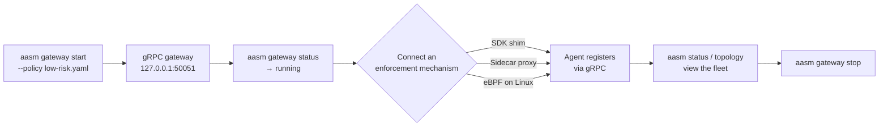
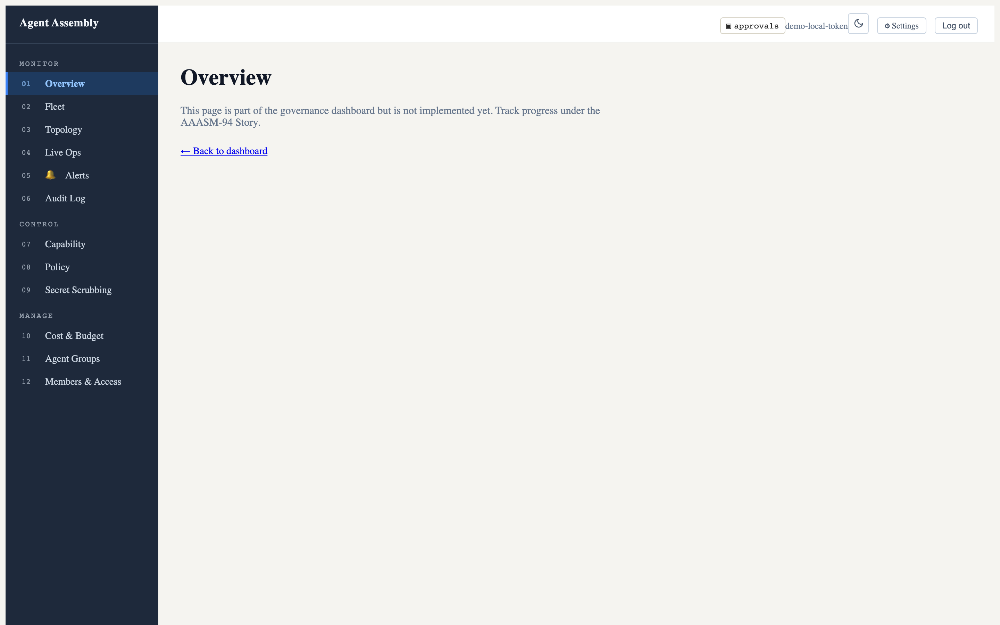

# First run

This walkthrough takes you from a freshly installed `aasm` to a running
governance gateway that is ready for an agent to connect. Every command and its
output below was captured from a real `v0.0.1-beta.4` build; only the version
strings shown are updated to the current release, without re-capturing.

## The flow



> **Two servers, two commands.** `aasm gateway start` brings up the **gRPC
> gateway on `127.0.0.1:50051`** — what SDK shims and the sidecar proxy connect to.
> `aasm start` brings up the **local API server**: the HTTP API and embedded
> dashboard on **`http://localhost:7391`**. The operator commands `aasm status`,
> `aasm agent`, and `aasm topology` talk to the HTTP API, and a bare `aasm status`
> follows the address `aasm start` is serving (7391 unless you passed `--port` or
> `--host`). Until `aasm start` is running they report `unreachable`; that is
> expected and called out at each step below.

## 1. Start the gateway

Point the gateway at one of the bundled reference policies. The repository's `policy-examples/`
directory has `low-risk.yaml`, `medium-risk.yaml`, and `high-risk.yaml`; `low-risk`
allows and audits everything, which is the easiest starting point.

The gRPC gateway is a separate binary, `aa-gateway`, which `cargo build -p aa-cli` does
**not** produce. Steps 1 and 2 (and everything that connects over gRPC) need it, so on a
source build build it first (skip this if you installed a release with `install.sh`, which installs it next to `aasm`):

```sh
cargo build -p aa-gateway
```

```console
$ aasm gateway start --policy policy-examples/low-risk.yaml
Gateway started on grpc://127.0.0.1:50051  (pid 74472)
Logs: /Users/you/.aasm/logs/gateway.log
```

This spawns `aa-gateway` as a detached background process listening for gRPC on
`127.0.0.1:50051`. (`aasm gateway start` looks for `aa-gateway` next to the `aasm`
executable, then on `$PATH`, then in `~/.cargo/bin` — never the current directory — so on a
source build run `./target/debug/aasm` or put `target/debug` on your `PATH`.)

> **Alternative — from a source checkout without installing:** the gateway can be
> run directly with Cargo, which is the form the rest of the book uses:
>
> ```sh
> cargo run -p aa-gateway -- --policy policy-examples/low-risk.yaml
> ```
>
> It listens on the same `127.0.0.1:50051`.

## 2. Confirm it is running

```console
$ aasm gateway status
Gateway: running  pid=74472  listen=127.0.0.1:50051  uptime=5s
```

If nothing is running you get a non-zero exit and:

```console
$ aasm gateway status
Gateway: not running
```

Tail the gateway log at any time with `aasm gateway logs`.

## 3. Check overall status

`aasm status` gives the fleet-wide picture — gateway health, registered agents,
pending approvals, and budget. It queries the **HTTP API at `http://localhost:7391`**,
the address `aasm start` serves. Only the gRPC gateway from step 1 is running so
far, so it reports `unreachable`:

```console
$ aasm status
Agent Assembly Status
─────────────────────────────────────
  Gateway:   http://localhost:7391
  Health:    ✗ unreachable
─────────────────────────────────────

RUNTIME HEALTH
──────────────
  API:         ✗ unreachable
  Uptime:      0s
  Connections: 0
  Lag:         0 ms

ACTIVE AGENTS
─────────────
  (no agents registered)

PENDING APPROVALS
─────────────────
  Count:  0

BUDGET STATUS
─────────────
  Daily spend : $-- (no limit set)
  Date:           --
  (no per-agent data)

Error: no Agent Assembly API answered at http://localhost:7391. Start it with: aasm start (or point the CLI at another with --api-url)
```

The `unreachable` health reflects the split described above: the gRPC gateway is
up, but nothing is serving the HTTP API yet. Start the local API server and ask
again — no flags needed, because `aasm status` reads the address `aasm start`
recorded. The installer's default set includes `aa-api-server`; on a source build, `aasm start`
needs it, and `cargo build -p aa-cli` does not produce it:

```sh
cargo build -p aa-api --bin aa-api-server
```

`aasm start` detaches the server: its output goes to an owner-only log file, not to your
terminal (so `aasm start | head` returns), and the command prints where it is.

```console
$ aasm start
✓ Agent Assembly gateway started
  Mode:    local
  Address: http://localhost:7391
  PID:     74601

  Log:     /Users/you/.aasm/aa-api-server.log
  Server:  aa-api-server 0.0.1-rc.8 from /Users/you/.cargo/bin/aa-api-server

$ aasm status
Agent Assembly Status
─────────────────────────────────────
  Gateway:   http://localhost:7391
  Health:    ✓ ok
─────────────────────────────────────
```

The `Server:` line names the `aa-api-server` that was launched, where it came from and the
version it reports. `aasm start` uses the first one next to `aasm`, on `$PATH` or in
`~/.cargo/bin`, so an older install can be picked up in place of your build. When that
version differs from `aasm`'s own, a `warning:` on stderr names both versions and the path.
It is a warning, not a refusal, because the pairing may be deliberate. The check runs only when
`aasm start` launches the server: if one is already running, `aasm start` reports that and
does not re-check it, so use `aasm status` to see the running server's version.

(Only the header is shown; the rest of the output follows the layout above.) If you
started the server with `--port 9123`, `aasm status` follows it there. An explicit
`--api-url`, `--context`, or `default_context` always takes precedence, and a server
started with `aasm start --foreground` records nothing, so pass `--api-url` for it
if you changed the port.

### The admin API key

`aasm status` works without a key. `aasm agent list`, `aasm topology overview` and the other
data commands are authenticated, and a freshly started server with no `AASM_API_KEY` set
**generates** a random admin key, prints only its first few characters, and does not store
it anywhere: that key cannot be recovered afterwards, so those commands answer
`authentication required`. To get a key you can use, choose one yourself, in the form `aa_`
followed by 32 hexadecimal characters, and start the server with it (keep it somewhere safe;
the server never writes it down):

```sh
export AASM_API_KEY="aa_$(openssl rand -hex 16)"
aasm start
aasm agent list
```

(`aasm agent list` then prints `No agents found.` on an empty registry.) A key in any other
form stops the server from starting, and `aasm start` says why instead of only timing out:

```console
$ AASM_API_KEY=not-a-key aasm start
aasm start: aa-api-server exited before it was ready at 127.0.0.1:7391
  aa-api-server output (full log: /Users/you/.aasm/aa-api-server.log):
    Error: "invalid AASM_API_KEY: API key must start with 'aa_'"
```

Run `aasm stop` to stop the server (it is the only way to stop a daemon whose output you
cannot see in your terminal).

Add `--watch` to auto-refresh the display every 5 seconds, or `--json` for a
machine-readable header suitable for scripting and CI.

## 4. Observe an agent

Agents register with the gateway through an **enforcement mechanism** — they
are not created from the CLI. Wire one of the SDKs into your agent, or front it with
the sidecar proxy, and point it at the gateway:

- **SDK shim (in-process):** install [python-sdk](https://github.com/ai-agent-assembly/python-sdk),
  [node-sdk](https://github.com/ai-agent-assembly/node-sdk), or
  [go-sdk](https://github.com/ai-agent-assembly/go-sdk) and follow that SDK's
  quickstart. The shim reports the calls it wraps to the gateway over gRPC.
- **Sidecar proxy (no agent code changes):** run `aasm proxy start` to intercept
  the agent's outbound HTTPS and forward governance decisions to the gateway. The
  agent process must route through the proxy and trust its CA.
- **eBPF (Linux only):** kernel hooks *observe* OpenSSL TLS plaintext and
  `exec`/file syscalls. They report what the layers above missed; they do not
  block it.

A quick way to exercise the sidecar path end-to-end is the bundled Docker
Compose stack, which runs `aa-runtime` as a sidecar against a stub agent:

```sh
cd examples/docker-compose
AA_API_KEY=dev-local-key docker compose up
```

The sidecar exposes the agent IPC socket at
`/tmp/aa-runtime-my-agent-001.sock` and a readiness probe at
`http://localhost:8080/ready`.

Once an agent is registered and the HTTP API is reachable, list the fleet:

```sh
aasm agent list          # all registered agents
aasm agent inspect <id>  # detail for one agent
```

Until then these commands report the API as unreachable:

```console
$ aasm agent list
error: API request failed: error sending request for url (http://localhost:7391/api/v1/agents)
```

### See a governed allow and deny

The gateway is not needed to watch a decision. To see a capability-lease runtime allow one
tool and deny another in a few commands, follow the
[worked example](../cli/lease.md#worked-example) and then
[See an allow and a deny](../cli/lease.md#see-an-allow-and-a-deny) on the `aasm lease`
page. It starts `aa-runtime` on its own, with a policy and a lease record you create, and
needs the Python SDK installed with its native module built.

## 5. View the topology

`aasm topology` visualizes the agent fleet — trees, lineage, teams, and
aggregate stats. Like `aasm status`, it reads the HTTP API:

```sh
aasm topology overview   # fleet-wide overview
aasm topology tree <id>  # subtree rooted at an agent
aasm topology stats      # aggregate statistics
```

With no reachable API it reports:

```console
$ aasm topology overview
error: registry unreachable — check --api-url
```

## 6. Open a dashboard

For a live, interactive view there are two consoles:

- **Web dashboard** — `aasm dashboard start` serves the embedded SPA at
  `http://127.0.0.1:3000` (port configurable; see
  [Configuration](configuration.md)). It blocks until `Ctrl-C`; use
  `aasm dashboard open` to launch your browser against an already-running server.
- **Terminal (TUI) dashboard** — `aasm dashboard` opens an interactive in-terminal
  dashboard for real-time monitoring, no browser required.

The web dashboard's app shell looks like this after you sign in — the full
governance navigation (Monitor / Control / Manage) down the left, with the
approvals indicator, theme toggle, Settings, and Log out across the top:



> The data panels are empty here because this is the open-source local-mode
> gateway, which serves the SPA but not the populated data API (that lives in
> the hosted control plane). See
> [Observe in the dashboard](../usage-guide/observe-in-dashboard.md) for the
> full picture, including the live-operations and dark-mode views.

## 7. Stop the gateway

When you are done, shut each server down cleanly (SIGTERM, escalating to SIGKILL
after the timeout). `aasm stop` stops what `aasm start` started; `aasm gateway stop`
stops the gRPC gateway:

```sh
aasm stop
```

```sh
aasm gateway stop
```

## Where to go next

- [CLI Reference](../cli/overview.md) — every `aasm` command and flag.
- [Usage Guide](../usage-guide/govern-an-agent.md) — govern an agent end-to-end, author
  policies, and set budgets.
- [Security Model](../security/overview.md) — the threat model and how the three
  enforcement mechanisms' claim levels combine.
